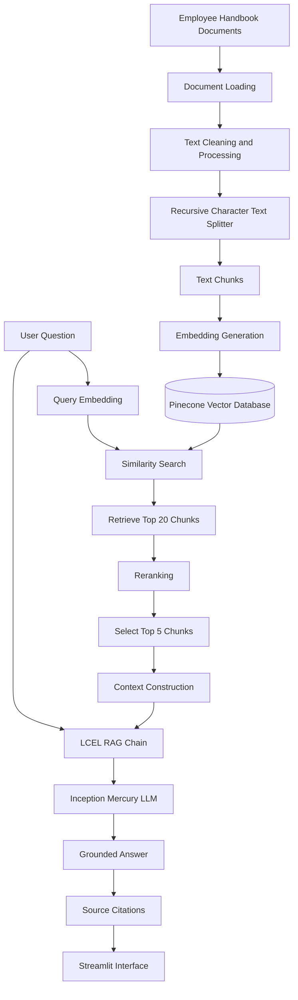

# Employee RAG Assistant

An AI-powered document question-answering application built using Retrieval-Augmented Generation (RAG). It allows users to ask questions about employee policies and receive context-grounded answers from organizational handbook documents.

**Live Demo:** https://employee-rag-assistant.streamlit.app/

**Repository:** https://github.com/kirtivish974/employee-rag-assistant

---

## Overview

Finding specific information in lengthy employee handbooks and organizational documents can be time-consuming.

Traditional keyword-based searches often fail to understand the intent behind a question. General-purpose LLMs, on the other hand, can generate answers that are not supported by an organization's actual documentation.

The Employee RAG Assistant addresses this problem using Retrieval-Augmented Generation.

Instead of relying entirely on the LLM's internal knowledge, the application retrieves relevant document passages from a vector database and uses them as context to generate answers.

The objective is to provide relevant, document-grounded responses with source references.

## Key Features

- **Document-based Question Answering:** Ask natural-language questions about employee handbook content.
- **Semantic Search:** Retrieve relevant document passages using vector embeddings.
- **Vector Database:** Store and search document embeddings using Pinecone.
- **Reranking:** Refine the initially retrieved results to prioritize more relevant context.
- **Context-Grounded Generation:** Generate answers using retrieved document context.
- **Source References:** Provide citations in `[S#]` format to connect answers with retrieved sources.
- **RAG Evaluation:** Evaluate answer quality and retrieval performance using RAGAS.
- **Interactive Interface:** Access the assistant through a Streamlit application.

## Architecture

The application follows a multi-stage Retrieval-Augmented Generation pipeline.



## RAG Pipeline

### 1. Document Ingestion

The ingestion pipeline loads organizational handbook documents and prepares them for retrieval.

The document collection includes Markdown, HTML, and PDF content.

The loaded documents are processed and converted into manageable text chunks.

### 2. Text Chunking

The application uses LangChain's `RecursiveCharacterTextSplitter`.

| Parameter | Value |
|---|---:|
| Chunk size | 700 |
| Chunk overlap | 100 |
| Start index metadata | Enabled |

Why chunking?

Sending entire documents to an LLM is inefficient and can introduce irrelevant information.

Chunking allows the system to retrieve smaller, more relevant passages instead of processing entire documents for every question.

### 3. Embedding Generation

The application uses the `multilingual-e5-large` embedding model.

Each text chunk is converted into a numerical vector representing its semantic meaning.

These vectors allow the system to identify relevant content based on meaning rather than relying exclusively on exact keyword matches.

### 4. Vector Storage

Pinecone is used as the vector database.

| Configuration | Value |
|---|---|
| Index name | `corp-docs-rag` |
| Embedding model | `multilingual-e5-large` |
| Vector dimensions | 1024 |
| Similarity metric | Dot Product |

Document embeddings and their associated content are stored in Pinecone for efficient similarity-based retrieval.

### 5. Semantic Retrieval

When a user submits a question:

1. The question is converted into an embedding.
2. Pinecone performs a similarity search.
3. The system retrieves the top 20 candidate chunks.

Retrieving multiple candidates provides a broader pool of potentially relevant information for the next stage.

### 6. Reranking

Initial vector similarity does not always guarantee that the retrieved passages are the most useful for answering a particular question.

To improve context selection, the application applies a reranking stage.

- Initial candidates: Top 20 chunks.
- Final selected context: Top 5 chunks.

This reduces the amount of context passed to the generation model while prioritizing relevance.

### 7. Answer Generation

The application uses LangChain Expression Language (LCEL) to orchestrate the RAG workflow.

The generation model is Inception Mercury (`mercury-3`), accessed through an OpenAI-compatible API using LangChain's `ChatOpenAI` interface.

The LLM receives:
- User question
- Retrieved document context
- Instructions for generating a context-grounded response

The model generates an answer based on the supplied context.

### 8. Source Citations

The application uses source references in `[S#]` format.

These references help users identify which retrieved passages support the generated answer.

## Technology Stack

| Component | Technology |
|---|---|
| Programming Language | Python |
| LLM Framework | LangChain |
| RAG Orchestration | LangChain Expression Language (LCEL) |
| Embedding Model | multilingual-e5-large |
| Vector Database | Pinecone |
| Generation Model | Inception Mercury 3 |
| LLM Integration | ChatOpenAI |
| Text Processing | RecursiveCharacterTextSplitter |
| User Interface | Streamlit |
| Evaluation | RAGAS |
| Version Control | Git & GitHub |

## RAG Evaluation

A RAG application should not be evaluated only by whether it generates fluent answers.

It must also be evaluated on whether it retrieves the right information and generates answers supported by that information.

This project uses the RAGAS framework to evaluate four important dimensions.

### Evaluation Metrics

| Metric | What it measures |
|---|---|
| Faithfulness | Whether the answer is supported by retrieved context |
| Answer Relevancy | Whether the generated answer addresses the question |
| Context Precision | Whether retrieved context is relevant |
| Context Recall | Whether retrieved context contains the required information |

### Evaluation Results

The following results were obtained from an evaluation dataset containing 21 questions.

| Metric | Average Score |
|---|---:|
| Faithfulness | 97.09% |
| Answer Relevancy | 87.43% |
| Context Precision | 90.77% |
| Context Recall | 98.41% |

**Key observations:**

- High faithfulness indicates that generated responses were generally grounded in retrieved context.
- High context recall indicates that the retrieval pipeline generally captured the information required by the evaluation questions.
- Answer relevancy has room for improvement.
- Context precision indicates opportunities to improve retrieval ranking.

These scores represent the current evaluation dataset and should not be interpreted as guaranteed production performance.

## Engineering Challenges

During development, several important RAG engineering challenges were encountered.

### 1. Duplicate Document Ingestion

Repeated ingestion can introduce duplicate chunks into a vector database.

This can affect retrieval quality by returning repeated or redundant passages.

The Pinecone index was deleted and re-ingested after duplicate chunks were identified.

### 2. Retrieval Versus Relevance

High similarity scores do not necessarily mean that a retrieved passage is useful for answering a particular question.

A separate reranking stage was introduced to refine the retrieved candidates.

### 3. Context Selection

Passing too many chunks to the generation model can introduce irrelevant information and increase context consumption.

The pipeline retrieves 20 candidates and selects 5 for answer generation.

### 4. Evaluation and Hallucination Detection

RAGAS evaluation helped identify cases where retrieval coverage, answer relevance, and answer grounding behaved differently.

For example, questions requiring personalized information, such as an employee's current PTO balance, cannot be reliably answered from a static handbook alone.

This highlights the importance of distinguishing organizational documentation from employee-specific live data.

## Limitations

The current application has several limitations:

- Answers depend on the quality and coverage of the indexed documents.
- Static handbook documents cannot provide live employee-specific information.
- Retrieval and generation quality can vary depending on question complexity.
- The current RAGAS evaluation dataset contains only 21 questions.
- Evaluation scores do not establish production-level reliability.
- The application is a demonstration project, not a complete enterprise HR management system.

## Future Improvements

Potential improvements include:

- Expand the RAGAS evaluation dataset.
- Improve retrieval quality through systematic retrieval experiments.
- Introduce hybrid search combining semantic and keyword retrieval.
- Add stronger handling of questions outside the knowledge base.
- Improve citation verification and source traceability.
- Introduce document versioning and incremental ingestion.
- Explore access control and permission-aware retrieval for enterprise use.
- Add observability, latency tracking, and cost monitoring.

## Running Locally

### Prerequisites

- Python
- Git
- Pinecone account and API credentials
- Inception API credentials

### 1. Clone the repository

```bash
git clone https://github.com/kirtivish974/employee-rag-assistant.git

cd employee-rag-assistant
```

### 2. Create a virtual environment

```bash
python -m venv venv
```

Activate it:

Windows:

```bash
venv\Scripts\activate
```

Linux/macOS:

```bash
source venv/bin/activate
```

### 3. Install dependencies

If the repository contains `requirements.txt`:

```bash
pip install -r requirements.txt
```

### 4. Configure environment variables

Create a `.env` file and configure the credentials required by the application.

- Pinecone API credentials
- Inception API credentials

Use the exact environment variable names expected by the application code.

Never commit API keys or other sensitive credentials to GitHub.

### 5. Run the application

Start the Streamlit application using its actual entry-point file:

```bash
streamlit run <streamlit_entrypoint>.py
```

The exact entry point and ingestion commands should match the repository's current implementation.

## Project Purpose

This project was developed to explore the practical engineering challenges involved in building a Retrieval-Augmented Generation application.

The focus was not just connecting an LLM to a vector database, but understanding and implementing the complete workflow:

**Document Ingestion → Chunking → Embeddings → Vector Search → Reranking → Context Construction → LLM Generation → Evaluation**

---

**Developed by Kirti Vishwakarma**

GitHub: https://github.com/kirtivish974

LinkedIn: https://www.linkedin.com/in/kirti-vishwakarma1/
